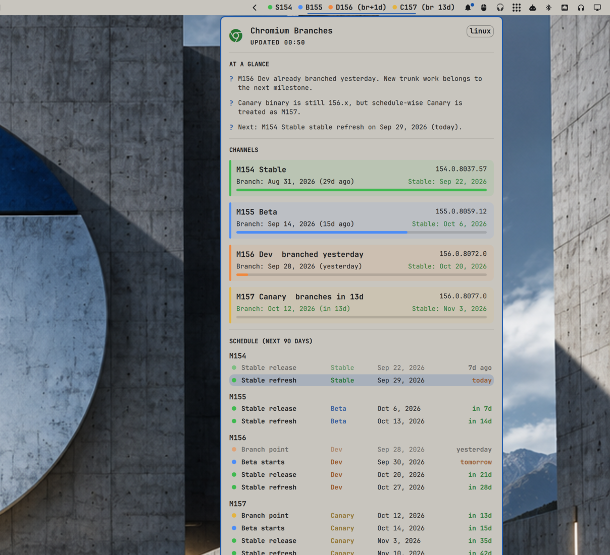

# Omarchiumdash

Omarchy bar widget that answers the daily Chromium question: which milestone
is Stable, Beta, Dev, and Canary right now, and when does it branch or ship?

Port of [chromiumdash-menubar](https://github.com/hjanuschka/chromiumdash-menubar)
(macOS) to the Omarchy shell.



## What it shows

In the bar:


- One colored pill per channel with its milestone: `S154 B155 D156 C157`
- Dev and Canary carry a branch countdown, e.g. `(br 13d)` or `(br+1d)`

In the panel ([full screenshot](docs/panel.png)):

- **At a glance** - hints about channel overlaps (for example, Stable and Beta
  on the same milestone), whether Dev has branched, and the next schedule
  event
- **Channels** - version, branch point, stable date, and a branch-to-stable
  progress bar for each channel. Click a card to see beta start/end, final
  beta cut, and stable refresh dates
- **Schedule** - timeline of branch, beta, stable, and refresh dates from
  10 days ago to 90 days ahead, grouped by milestone; today is highlighted
- **CL & issue bookmarks** - paste a CL number, a Gerrit or crrev URL, or an
  issues.chromium.org / crbug.com link. CLs show live Gerrit status (ACTIVE,
  SUBMITTABLE, MERGE CONFLICT, MERGED, ABANDONED), owner, branch, and the
  latest review message
- **Show in bar** - choose which channels appear in the bar pill

Canary is treated as the next milestone once Dev has branched, even while the
Canary binary still reports the old major version. ChromiumDash does the same.

## Install

```sh
omarchy plugin add https://github.com/hjanuschka/omarchiumdash.git --enable
```

The widget is added to the right section of the bar. If it doesn't show up
right away:

```sh
omarchy-shell shell rescanPlugins
```

Move it with `omarchy bar move hjanuschka.omarchiumdash --section center`.

## Usage

| Input | Action |
|---|---|
| Left click | Open / close the panel |
| Middle click | Refresh now |
| Right click | Open the ChromiumDash schedule in the browser |
| `r` (panel open) | Refresh |
| `Esc` | Close the panel |
| `Tab` / `Shift+Tab` | Switch to the neighboring bar panel |

In the bookmark field, press `Enter` to add. Click a CL to expand its latest
message. Use the icons on a row to open it in the browser or remove it.

## Settings

Add these to the widget's entry in `~/.config/omarchy/shell.json`, or set
them in the plugin settings UI:

| Key | Default | Description |
|---|---|---|
| `platform` | `linux` | Platform whose versions are shown: `linux`, `mac`, `win64`, `android` |
| `refreshMinutes` | `60` | Auto refresh interval, minimum 5 |

```json
{ "id": "hjanuschka.omarchiumdash", "platform": "mac", "refreshMinutes": 30 }
```

Bar channel visibility and bookmarks are saved to
`~/.local/state/omarchiumdash.json` (or `$XDG_STATE_HOME/omarchiumdash.json`).

## Data sources

All requests are anonymous, read-only HTTPS GETs:

- Channel versions: `https://versionhistory.googleapis.com/v1/chrome/platforms/<platform>/channels/<channel>/versions/`
- Milestone schedule: `https://chromiumdash.appspot.com/fetch_milestone_schedule?mstone=<n>`
- CL status: the public Gerrit REST API on `*-review.googlesource.com`

## Remove

```sh
omarchy plugin remove hjanuschka.omarchiumdash
rm -f ~/.local/state/omarchiumdash.json   # optional: drop saved bookmarks
```

The plugin doesn't touch any other config file.

## Development

```sh
git clone https://github.com/hjanuschka/omarchiumdash.git
ln -s "$PWD/omarchiumdash" ~/.config/omarchy/plugins/hjanuschka.omarchiumdash
omarchy plugin validate "$PWD/omarchiumdash"
node --test omarchiumdash/tests/
```

`Model.js` holds all the date, schedule, and bookmark logic and is covered by
the node tests. `Panel.qml` handles the UI and networking.

## Dependencies

Omarchy (Quickshell shell), `curl` for network requests, and `xdg-open` for
opening links. `curl` and the coreutils used by `scripts/io.sh` ship with every
Omarchy install, so you don't need to add anything.

All network and state-file I/O runs through `scripts/io.sh` rather than
Quickshell's `XMLHttpRequest`/`FileView`, which cannot bound response size or
open files without following symlinks. The helper enforces HTTPS-only,
host-allowlisted requests with hard byte and time ceilings, and reads/writes the
state file with descriptor-bound no-follow checks and an atomic temp-and-rename.

## License

MIT. See [LICENSE](LICENSE).
